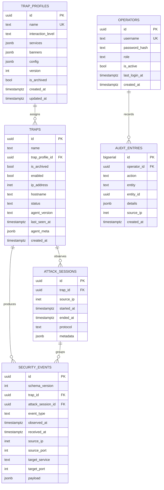

# HoneyForge — схема базы данных

Эта схема соответствует MVP-спецификации и ADR-0004. В MVP ровно шесть таблиц; Honeytoken storage появится только вместе с Bonus-функцией.

## Инварианты

- `SecurityEvent.id` — UUID события и идемпотентный ключ доставки.
- `received_at` задаётся Control Center; выдача Security Events сортируется по
  `(received_at DESC, id DESC)`, а `observed_at` показывается отдельно и не влияет
  на порядок или retention.
- Traps и ранее назначенные Trap Profiles архивируются, а Security Events, Attack Sessions и audit entries неизменяемы до retention cleanup.
- `Trap.enabled` — желаемое состояние оператора; `Trap.status` — фактическое
  состояние, которое подтверждает Agent через Health Report. `enabled = false`
  показывает Trap как `stopped`: Agent останавливает сервисы, но продолжает
  доставку буфера и Health Reports.
- Security data хранится `SECURITY_DATA_RETENTION_DAYS` (30 дней по умолчанию),
  audit entries — `AUDIT_ENTRY_RETENTION_DAYS` (365 дней); фоновая очистка
  запускается каждые `RETENTION_SWEEP_INTERVAL_SECONDS` (сутки по умолчанию).
- PostgreSQL notification передаёт только UUID Security Event; listener загружает полную запись из БД.

## Индексы Security Events

- `(received_at, id)` — стабильная cursor pagination.
- `(trap_id, received_at)`, `(attack_session_id, received_at)`,
  `(source_ip, received_at)` и `(event_type)` — фильтры расследования.

## Таблицы

| Таблица | Назначение |
|---|---|
| `trap_profiles` | Версионируемые настройки сервисов и поведения Trap |
| `traps` | Реестр развёрнутых Trap и их Trap Status |
| `attack_sessions` | Группировка связанных Security Events |
| `security_events` | Нормализованные наблюдения активности атакующего |
| `operators` | Аутентифицированные Operator |
| `audit_entries` | Изменяемые Operator действия, требующие аудита |
