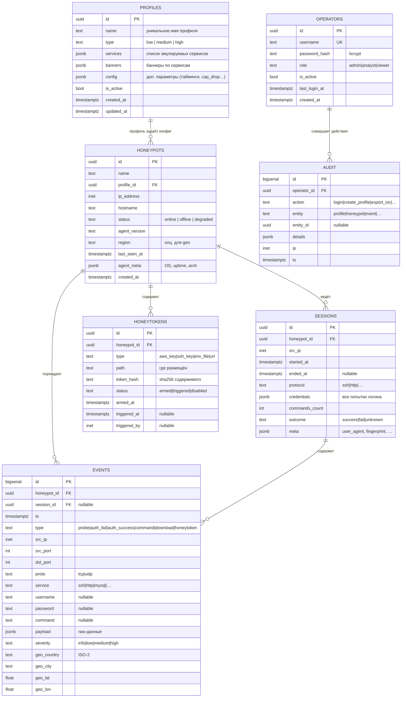

# HoneyForge — Схема базы данных

> ER-исходник: [`database.mmd`](./database.mmd) · PNG: `docs/media/database.png`

## 3.1. ER-диаграмма



## 3.2. Назначение таблиц

| Таблица | Назначение | Источник данных | Ключевые FR |
|---|---|---|---|
| `profiles` | Шаблоны конфигурации ловушек (какие сервисы эмулировать, какие баннеры, лимиты) | Оператор через UI | FR-C1 |
| `honeypots` | Реестр развёрнутых ловушек + их статус | Агент при регистрации + heartbeat | FR-C2 |
| `events` | Все зафиксированные взаимодействия (нормализованные) | Агент → Collector | FR-A2, FR-C4 |
| `sessions` | Логические сессии (SSH-сессия, HTTP-сессия), группируют события | Collector при обработке батча | FR-A3 |
| `honeytokens` | Фейковые секреты и их статус | Оператор + детектор агента | FR-A6 (Bonus) |
| `operators` | Учётные записи операторов SOC | Admin через seed/CLI | FR-C5 |
| `audit` | Журнал действий оператора (кто что менял) | FastAPI middleware | безопасность |

## 3.3. Индексы (Must для производительности)

```sql
-- events: основные фильтры UI
CREATE INDEX idx_events_ts          ON events (ts DESC);
CREATE INDEX idx_events_honeypot    ON events (honeypot_id, ts DESC);
CREATE INDEX idx_events_src_ip      ON events (src_ip, ts DESC);
CREATE INDEX idx_events_type_sev    ON events (type, severity);

-- sessions: поиск по IP и ловушке
CREATE INDEX idx_sessions_honeypot  ON sessions (honeypot_id, started_at DESC);
CREATE INDEX idx_sessions_src_ip    ON sessions (src_ip);

-- honeypots: быстрый список online
CREATE INDEX idx_honeypots_status   ON honeypots (status) WHERE status <> 'offline';

-- honeytokens: проверка «взведён ли»
CREATE INDEX idx_honeytokens_armed  ON honeytokens (honeypot_id, status) WHERE status = 'armed';
```

## 3.4. Триггер `NOTIFY` (Bonus 1.4, реальный realtime)

```sql
CREATE OR REPLACE FUNCTION notify_new_event() RETURNS trigger AS $$
BEGIN
  PERFORM pg_notify('events_new', row_to_json(NEW)::text);
  RETURN NEW;
END;
$$ LANGUAGE plpgsql;

CREATE TRIGGER trg_events_notify
AFTER INSERT ON events
FOR EACH ROW EXECUTE FUNCTION notify_new_event();
```

`pg_listener.py` подписывается на канал `events_new` через asyncpg и пушит событие в WebSocket-менеджер.

## 3.5. Политика хранения

- `events` — партиционировать по `ts` (range, monthly) — опционально, если объём большой.
- `audit` — retention 1 год.
- `events` — retention 90 дней в демо (в проде — на усмотрение).
- `honeytokens` с `status='disabled'` — soft-delete, не удалять физически (нужны для истории).

## 3.6. Демо-данные (`seed_demo.py`)

Минимум для защиты:

- **3 профиля:** `low-web`, `medium-ssh`, `medium-http-admin`.
- **3 ловушки:** по одной на профиль, статусы `online`, `online`, `offline`.
- **1 оператор:** `admin / honeyforge` (bcrypt-хэш).
- **~50 событий** в `events` за последние сутки (разные `src_ip`, `type`, `severity`) — чтобы dashboard и графики были не пустыми.
- **1 honeytoken** `aws_key`, `status=armed`.

## 3.7. Замечания по реализации

- Проверить, что `pg_notify` payload не превышает 8000 байт — если событие жирное, слать только `id`, а детали тянуть из БД в listener'е.
