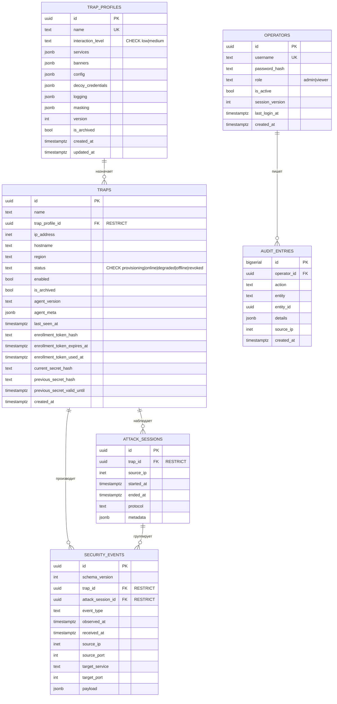

# HoneyForge — схема базы данных

В БД ровно **шесть таблиц**: конфигурация ловушек, сами ловушки,
наблюдения, операторы и аудит. Отдельного хранилища honeytoken'ов нет — оно
появилось бы вместе с нереализованной Bonus-функцией FR-A6.

Схема соответствует моделям `center/api/models/*.py` и миграциям
`20261012_0001` … `20261016_0006`. Исходник диаграммы: `docs/database.mmd`.

## Таблицы

| Таблица | Назначение | Ключевые детали |
|---|---|---|
| `trap_profiles` | Версионируемая конфигурация поведения ловушки (FR-C1) | `name` уникален; `version` участвует в `If-Match`; `banners` и `config` — перенесённые из ранней схемы колонки, API их не заполняет |
| `traps` | Реестр развёрнутых ловушек, их статус и учётные данные подключения | Хранятся **только хэши** секретов; токен регистрации никогда не сохраняется в открытом виде |
| `attack_sessions` | Группировка связанных Security Events | `started_at` = `observed_at` первого события; `ended_at` закрывается на `connection_closed` |
| `security_events` | Нормализованные наблюдения активности атакующего | PK = `id` события (идемпотентность доставки); `received_at` ставит только центр |
| `operators` | Учётные записи операторов | Уникальный `username`, `role`, `session_version` для принудительного сброса сессий |
| `audit_entries` | Действия операторов, требующие аудита | Пишется при каждом изменении и при **отказе** по правам (`operator.access.denied`) |

## Инварианты

- **Идемпотентность.** `security_events.id` одновременно идентификатор события и
  ключ доставки. Повтор с теми же данными принимается как дубликат, повтор с
  другими данными отклоняется `422`. Гарантия exactly-once обеспечивается
  уникальным ключом в PostgreSQL и advisory-lock по `trap_id` внутри транзакции.
- **Время.** `received_at` проставляет **только Control Center**. Порядок выдачи и
  retention определяются `received_at`, а `observed_at` показывается отдельно и не
  влияет ни на порядок, ни на очистку.
- **Неизменяемость.** Security Events, Attack Sessions и audit entries не
  изменяются до retention cleanup. Настоящие «мягкие» удаления есть только у
  ловушек и профилей (`is_archived`).
- **Каскады.** Ссылки на ловушку и сессию объявлены с `ON DELETE RESTRICT`, поэтому
  удалить ловушку с событиями нельзя случайно: `DELETE /api/v1/traps/{id}` сначала
  явно чистит события, сессии и аудит этой ловушки в одной транзакции.
- **Состояние ловушки.** `traps.enabled` — желаемое состояние оператора,
  `traps.status` — фактическое, подтверждённое агентом через Health Report. Для
  интерфейса вычисляется `display_status`: выключенная ловушка показывается как
  `stopped`, даже если последний статус агента был `online`.
- **Профиль — полный контракт поведения (FR-C1).** `services` (протокол, порт,
  баннер, `emulator_settings`), `decoy_credentials`, `logging` и `masking`.
  Control Center выдаёт их агенту через `GET /assets/v2/config`, и агент их
  применяет: `decoy_credentials`, `logging`, `masking` (интервал и джиттер
  beacon'а, `User-Agent`) и `emulator_settings`
  (`response_delay_ms`, `response_jitter_ms`, `max_attempts`).
- **Роли операторов.** `operators.role` — `admin` (полный доступ) или `viewer`
  (только чтение). Разграничение доступа (FR-C5) действует на всех изменяющих
  операциях API; запрещённая попытка сохраняется в `audit_entries`.
- **Уведомления.** Триггер после вставки события отправляет `NOTIFY security_events`
  с одним UUID. Listener перечитывает полную запись из БД — в канал уходит только
  идентификатор.
- **Retention.** Security data живёт `SECURITY_DATA_RETENTION_DAYS` (30 дней),
  audit entries — `AUDIT_ENTRY_RETENTION_DAYS` (365 дней). Фоновая очистка идёт
  каждые `RETENTION_SWEEP_INTERVAL_SECONDS` (сутки) и удаляет события вместе с
  осиротевшими Attack Sessions.

## Индексы Security Events

| Индекс | Для чего |
|---|---|
| `idx_security_events_received_at` | Хронологическая выдача и retention |
| `idx_security_events_received_id` | Стабильная курсорная пагинация `(received_at, id)` |
| `idx_security_events_trap` | Фильтр по ловушке |
| `idx_security_events_attack_session` | Разбор атаки по сессии |
| `idx_security_events_source_ip` | Фильтр по источнику |
| `idx_security_events_type` | Фильтр по типу события |

Ограничения целостности заданы `CHECK`: `trap_profiles.interaction_level IN
('low','medium')`, `traps.status IN ('provisioning','online','degraded','offline',
'revoked')` и список из семи `security_events.event_type`.

## Миграции

| Ревизия | Что добавляет |
|---|---|
| `20261012_0001` | Начальная схема: 6 таблиц, индексы, триггер `NOTIFY` |
| `20261014_0002` | Канал уведомлений `security_events` для realtime |
| `20261015_0003` | Индексы расследования по ловушке, сессии, источнику и типу |
| `20261015_0004` | `traps.enabled` — разделение желаемого и фактического состояния |
| `20261015_0005` | Состав профиля по FR-C1: `decoy_credentials`, `logging`, `masking` |
| `20261016_0006` | Расширенная телеметрия: события `payload_received` и `database_query` (schema v2) |

Откат `20261016_0006` блокируется, если события версии 2 уже сохранены: история не
удаляется автоматически ради возврата старого ограничения.

## Чего в схеме нет

- **Geo/ASN и агрегатов** — нет ни колонок, ни отдельной таблицы обогащения.
- **Артефактов загруженных файлов** — нет blob-хранилища: в `payload` попадает
  ограниченный фрагмент (до 64 КиБ) с хэшем всего наблюдённого входа.
- **Honeytoken'ов** — нет таблицы (FR-A6 не реализован).
- **Журнала аудита в API** — таблица `audit_entries` есть и наполняется, но
  читающего эндпоинта и экрана пока нет.